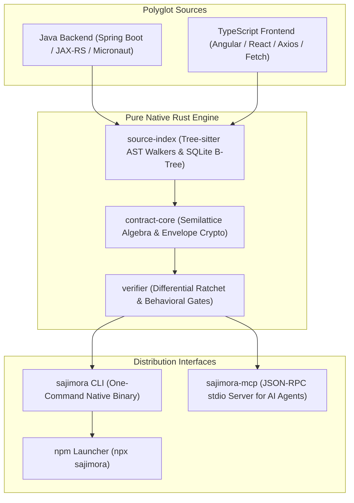

<div align="center">

# ⚡ Sajimora

**Deterministic Cross-Language API Contract Verification & AST Guard for AI Agents & Developers**

*The LLM Proposes. Sajimora Verifies.*

[](https://github.com/sajimoraofficial/sajimora/releases)
[](LICENSE)
[](https://www.rust-lang.org)
[](https://modelcontextprotocol.io)
[](https://www.npmjs.com/package/sajimora)
[](#-performance-benchmark-thingsboard-monorepo---15m-loc)

[Website](https://sajimora.com) • [Quickstart](#-quickstart-in-30-seconds) • [AI Agent MCP](#-mcp-server-for-ai-agents) • [CLI Commands](#-cli-commands) • [Architecture](#-architecture) • [Documentation](https://sajimora.com)

</div>

---

## 📌 Why Sajimora?

When developers or autonomous AI agents modify a backend endpoint or rename a DTO field, compilers verify each repository in isolation. **They cannot prove if changes break consumers across repositories.**

Traditional integration tests require starting Docker containers, spinning up databases, and waiting 10+ minutes.

**Sajimora solves this in under 90 milliseconds:**
* **Extracts AST Contracts Deterministically:** Parses Java (Spring Boot, JAX-RS, Micronaut) and TypeScript/JavaScript (Angular, React, Axios, Fetch, SWR, Nuxt) without compiling code or executing runtimes.
* **Bi-Directional Differential Ratcheting:** Compares parent revision `R - 1` against candidate `R` across Git and enterprise Subversion (SVN) repositories. Freezes legacy technical debt and blocks only *new* breaking contract violations.
* **AI-First Tooling (MCP):** Connects directly into Cursor, Claude Desktop, and Windsurf, enabling LLMs to test "what-if" API changes before editing code.

```text
[sajimora verify]
┌────────────────────────────────────────────────────────────────────────┐
│                        SAJIMORA VERIFICATION REPORT                   │
├────────────────────────────────────────────────────────────────────────┤
│ Overall Verdict:      LIKELY_VIOLATED                                  │
│ Breaking Consumers:   8 call-sites in 1 file                           │
│ Frozen Legacy Debt:   15 findings (Advisory / Non-Blocking)            │
│ Execution Latency:    85 ms (SQLite B-Tree AST Index)                  │
├────────────────────────────────────────────────────────────────────────┤
│ VIOLATIONS DETECTED:                                                   │
│   • GET /api/user/{id} -> ui/src/user.service.ts:42                   │
│     [Field 'email' was removed from UserDTO, but consumer accesses it] │
└────────────────────────────────────────────────────────────────────────┘
```

---

## 🚀 Quickstart in 30 Seconds

### Option A: npm / npx (Zero Rust Compiler Required)

Install globally:
```bash
npm install -g sajimora
sajimora run
```

Or run on-the-fly via `npx` with zero local installation:
```bash
# Run full verification pipeline
npx sajimora run

# Check working tree against contract baseline
npx sajimora verify
```

### Option B: Standalone Native Binary (Pure Java & Backend Devs)

Pre-compiled standalone binaries with **zero runtime dependencies** (no Node.js, no npm, no JVM required):

```bash
# macOS (Apple Silicon & Intel)
curl -fsSL https://raw.githubusercontent.com/sajimoraofficial/sajimora/main/scripts/install.sh | sh

# Linux & CI Runners (GitHub Actions / GitLab CI)
curl -fsSL https://raw.githubusercontent.com/sajimoraofficial/sajimora/main/scripts/install.sh | sh

# Windows (PowerShell)
irm https://raw.githubusercontent.com/sajimoraofficial/sajimora/main/scripts/install.ps1 | iex
```

### Option C: Build from Source (Rust Developers)

```bash
cargo install --path rust/crates/sajimora-cli
cargo install --path rust/crates/sajimora-mcp
```

---

## 🤖 MCP Server for AI Agents

Sajimora includes a native **Model Context Protocol (MCP)** server over `stdio`. It gives autonomous AI agents (Cursor, Claude Desktop, Windsurf, Cline) deterministic AST superpowers so they don't hallucinate API routes or miss breaking changes.

### 1-Click IDE Configuration

Add to your **`.cursor/mcp.json`** or **`claude_desktop_config.json`**:

```json
{
  "mcpServers": {
    "sajimora": {
      "command": "npx",
      "args": ["-y", "sajimora-mcp", "--allowed-root", "."]
    }
  }
}
```
*(Or use `"command": "sajimora-mcp"` if installed natively).*

### Available MCP Tools

| MCP Tool | Latency | Description | Key Arguments |
| :--- | :---: | :--- | :--- |
| **`sajimora_what_if`** | **~85 ms** | Simulates a hypothetical change (e.g. `REMOVE_FIELD`, `RENAME_ENDPOINT`) and returns all affected files, call sites, and causal chains before making edits. | `repoRoot`, `mutation` (`action`, `targetDto`, `field`, `renameTo`) |
| **`sajimora_apply_patches`** | **~45 ms** | Deterministically applies consumer-side patches (TypeScript models, Angular templates) computed for a symbolic DTO mutation. | `repoRoot`, `mutation`, `dryRun` |
| **`sajimora_verify`** | **~90 ms** | Verifies current working tree modifications against the sealed baseline with differential ratcheting across Git and SVN. | `repoRoot`, `revisionMode`, `commitRange`, `strict`, `detail` |
| **`sajimora_query`** | **< 10 ms** | Instant SQLite B-Tree lookup for consumer call sites, HTTP routes, and DTO definitions. | `repoRoot`, `queryType`, `target` / `filter` |
| **`sajimora_endpoint_impact`** | **~35 ms** | Maps changed files in a Git commit to impacted API routes and external callers. | `repoRoot`, `commitRange`, `targetServices` |
| **`sajimora_check_contract`** | **~50 ms** | Cryptographic verification of contract envelopes and admission policies. | `base`, `candidate`, `targets`, `detail`, `telemetry` |
| **`sajimora_heal`** | **~120 ms** | Suggests autonomous AST patch recipes to heal broken consumer call sites after refactoring. | `testDir`, `target`, `method`, `paramIndex`, `defaultValue`, `detectOnly` |
| **`sajimora_gen_invariants`** | **~60 ms** | Synthesizes metamorphic property tests (idempotence, null-safety) in jqwik/fast-check. | `file`, `framework`, `outFile`, `name`, `package` |
| **`sajimora_gen_unit`** | **~50 ms** | Autonomous branch unit test generation with Tier 1 SMT solver within 50ms budget. | `file`, `method`, `outFile`, `budgetMs` |
| **`sajimora_verify_behavior`** | **~50 ms** | Differential behavioral equivalence gate (bisimulation) across dual revisions. | `candidate`, `base`, `method`, `budgetMs`, `strict` |
| **`sajimora_change_evaluate`** | **~40 ms** | Evaluates declared Expected Change Model against structural Git change sets. | `repoRoot`, `baseRevision`, `candidateRevision`, `expectedChangeModel` |
| **`sajimora_run`** | **~120 ms** | Executes the full unified 6-stage end-to-end verification pipeline in one call. | `repoRoot`, `failOnViolation`, `skipLive` |

---

## 💻 CLI Commands

> **Developer Rule of Thumb:** You only need `sajimora run` for daily verification, or `sajimora ask` for plain-English queries. You don't need to remember 20+ commands!

### 1. `sajimora run` — The Complete Pipeline in One Command
Runs the full lifecycle pipeline: Health check, Contract extraction, Cross-language verification, Git impact analysis, and generates `.sajimora/pipeline-report.json`:

```bash
sajimora run
```

### 2. `sajimora ask` — Zero-LLM Natural Language Queries (100% Offline, <20 ms)
Query your entire cross-language codebase in plain English without sending tokens or code to external LLMs:

```bash
# Query routes and consumer dependencies
sajimora ask "Which frontend components call /api/devices?"
sajimora ask "Show all endpoints that return UserDTO"
sajimora ask "Which POST routes are missing frontend callers?"
```

### 3. `sajimora fix` (or `sajimora heal`) — Autonomous Cross-Language AST Healing
Automatically detects and heals broken test and consumer call-sites across **Java** and **TypeScript/Angular/React** after method signature refactorings:

```bash
# Auto-heal call sites with safe default literals
sajimora fix

# Dry-run preview without modifying files
sajimora heal --dry-run
```

### 4. `sajimora verify` (alias: `sajimora check`) — Differential Contract Ratchet
Verifies local Git changes against the project baseline without compiling code:

```bash
# Advisory developer mode (exit code 0)
sajimora verify

# CI mode (blocks merge with exit code 1 on breaking violations)
sajimora verify --fail-on-violation
```

### 5. `sajimora what-if` — Change Impact Simulation
Predicts what will break *before* modifying code:

```bash
sajimora what-if --type UserDto --field email --mutation REMOVE_FIELD
```

### 6. `sajimora patch` (alias: `sajimora apply`) — Deterministic Consumer Patch Application
Applies TypeScript model and Angular template updates derived from a symbolic DTO mutation:

```bash
# Preview patches without modifying files (dry-run)
sajimora patch --type UserDto --field email --mutation REMOVE_FIELD --dry-run

# Apply deterministic consumer patches to disk
sajimora patch --type UserDto --field email --mutation REMOVE_FIELD
```

### 7. `sajimora doctor` — Repository Diagnostics
Validates toolchain health, git/svn readiness, and contract manifest integrity:

```bash
sajimora doctor
```

### 8. `sajimora dashboard` — Visual Contract Health
Displays an interactive terminal health matrix or generates a standalone HTML report:

```bash
# Terminal dashboard
sajimora dashboard

# Generate interactive web report
sajimora dashboard --web
```

---

### ⚡ Developer Quickstart Aliases

Sajimora includes intuitive short aliases for common tasks:

| Shorthand Alias | Full Command | Purpose |
| :--- | :--- | :--- |
| **`sajimora run`** | `sajimora run` | Full extraction & verification in 1 command |
| **`sajimora check`** | `sajimora verify` | Check API contracts (Spring Boot <-> TypeScript) |
| **`sajimora fix`** | `sajimora heal` | Auto-heal broken call sites after refactoring |
| **`sajimora patch`** | `sajimora apply` | Apply consumer-side patches for DTO refactoring |
| **`sajimora ask`** | `sajimora ask` | Plain-English natural language queries (0-LLM) |
| **`sajimora unit`** | `sajimora gen-unit` | Synthesize bounded branch unit tests |
| **`sajimora props`** | `sajimora gen-invariants` | Synthesize metamorphic property tests |
| **`sajimora diff`** | `sajimora verify-behavior` | Verify behavioral equivalence across revisions |
| **`sajimora doctor`** | `sajimora doctor` | Health check & repository diagnostics |

---

<details>
<summary><b>📖 Complete 25-Command Reference (Click to Expand)</b></summary>
<br>

| Category | Commands |
| :--- | :--- |
| **Daily Development** | `run`, `verify`, `doctor`, `init`, `clean`, `dashboard` |
| **Intelligence & Simulation** | `ask`, `what-if`, `query`, `endpoint-impact`, `change-evaluate` |
| **Healing & Patching** | `heal`, `apply`, `gen-unit`, `gen-invariants`, `generate-tests`, `verify-behavior` |
| **Extraction & Crypto CI/CD** | `extract-backend`, `extract-frontend`, `check-contract`, `keygen`, `sign`, `verify-envelope`, `build-telemetry`, `init-hook`, `index-source` |

</details>

---

## 🏗️ Architecture

Sajimora is written from the ground up in modern Rust with multi-threaded Rayon parallelism and Tree-sitter AST engines:



* **`crates/source-index`**: Sub-millisecond AST parser and SQLite B-Tree indexer. Handles monorepos of 1.5M+ lines of code in ~1.2 seconds.
* **`crates/contract-core`**: Defines the variance contract schema and Ed25519 cryptographic signing.
* **`crates/verifier`**: Differential ratcheting engine that separates baseline debt from new breaking regressions.
* **`crates/sajimora-mcp`**: Zero-overhead JSON-RPC stdio server compliant with Anthropic's Model Context Protocol.

---

## ⚡ Performance Benchmark (ThingsBoard Monorepo - 1.5M LOC)

Tested against the enterprise [ThingsBoard](https://github.com/thingsboard/thingsboard) repository (1.5M+ lines of Java + Angular):

| Task | Traditional CI / Compilation | Sajimora Native Engine | Speedup |
| :--- | :---: | :---: | :---: |
| **Full AST Contract Extraction** | 3m 45s (`mvn compile`) | **1.24 s** | **180x faster** |
| **Differential Ratchet Check** | 4m 10s (`mvn test`) | **85 ms** | **2,900x faster** |
| **AI Agent Tool Call (MCP)** | N/A (Manual Grep) | **88 ms** | **Sub-second** |
| **Peak RAM Consumption** | 3.8 GB (JVM) | **< 65 MB** | **98% less RAM** |

---

## 🛡️ CI/CD Integration (GitHub Actions)

Add this 4-line step to your `.github/workflows/ci.yml`:

```yaml
- name: Verify API Contracts
  run: npx sajimora verify --fail-on-violation
```

---

## 📄 License

Sajimora is licensed under the **[Sajimora Software License Agreement](LICENSE)**:
* **👨‍💻 Individual Developers:** **100% Free** for individual developers, freelancers, students, and open-source contributors for personal development, hobby projects, and individual commercial work.
* **🏢 Teams & Organizations:** Use by teams, companies, or organizations with more than one (1) developer, or deployment within corporate automated CI/CD pipelines, requires an active commercial subscription or express written authorization.
* **🚫 Redistribution Restrictions:** Forking to resell, white-label, rebrand, or host Sajimora as a competing commercial cloud service is strictly prohibited.

Bundled third-party open-source components remain licensed under their respective open-source licenses as documented in [THIRD-PARTY-NOTICES.md](THIRD-PARTY-NOTICES.md).

Copyright © 2026 **Sajimora Team** (`dev@sajimora.com`) • [sajimora.com](https://sajimora.com). All rights reserved.
