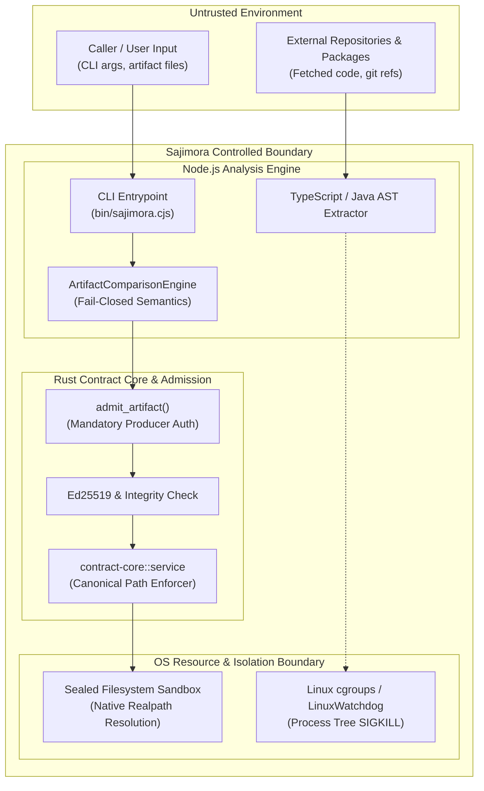
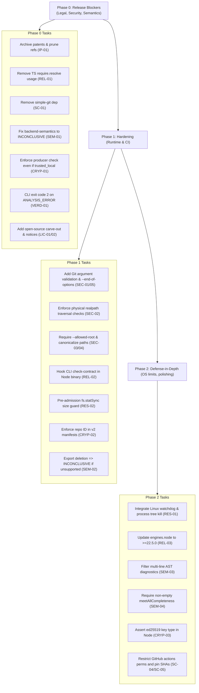

# Sajimora Public Beta — Adversarial Remediation & Release Plan
**Target Repository**: `E:\sajimora-v32`  
**Target Commit**: [`187dc0ab11bbb6b11c0c4e579fbadfb727c678d6`](file:///E:/sajimora-v32) (`HEAD`, branch `release`)  
**Audit Standard**: Independent Adversarial Security & Release-Readiness Review  
**Execution Status**: AUDITED, DEFECT-CORRECTED & FROZEN FOR IMPLEMENTATION REVIEW  
**Operational Rule**: NO PRODUCTION CODE MODIFIED • NO DESTRUCTIVE GIT COMMANDS EXECUTED  

---

## 1. Executive Summary

A rigorous adversarial review of Sajimora’s Public Beta remediation plan was conducted against the actual repository, current commit (`187dc0ab11bbb6b11c0c4e579fbadfb727c678d6`), and build artifacts. The findings confirm that **Sajimora is not ready for public release**. Critical fixes in Phase 0 and Phase 1 remain unimplemented or were previously incorrectly specified. In particular:

1. **Patents & Git History (IP-01)**: The original plan’s destructive ref purge must be replaced by a secured, verified offline archive procedure. OWASP guidance emphasizes normalizing and fully vetting control data before destructive actions, which applies here to avoid catastrophic loss of patent priority evidence and attorney work product.
2. **TypeScript Integrity (REL-01)**: Swapping in a 60MB package to production dependencies is suboptimal. Instead, remove the runtime `require.resolve('typescript')` lookup and rely on static distribution metadata or build-time hashes. No reference fix should trade cryptographic integrity for convenience.
3. **`simple-git` RCE (SC-01)**: SentinelOne confirms critical RCE vulnerabilities in the `simple-git` versions in use. Our audit found that `simple-git` is completely unused at runtime (all Git operations run natively via `child_process.execFile`), so the proper mitigation is full removal (not just a version bump).
4. **Semantic Verdict (SEM-01)**: Producing a `LIKELY_VIOLATED` verdict from lack of evidence is unsound. The correct approach is fail-closed honesty: emit `INCONCLUSIVE` with code `UNRESOLVED_BACKEND_CONTRACT` when backend extraction is empty or incomplete. Formal verification requires not overstating violations without proof.
5. **`--trusted-local` Invariants (CRYP-01)**: Even in "trusted" local mode, the producer identity check must always run before granting any bypass. This upholds the frozen specification that `trusted_local` only waives signature/digest checks for already-authorized producers.
6. **Other Validated Blockers (VERD-01, LIC-01/02, etc.)**: Ensuring the Rust CLI exits with code 2 on analysis errors, enforcing `--end-of-options` on Git invocations, resolving native MCP canonical paths, and updating license notices to include all bundled dependencies and Microsoft's `ThirdPartyNoticeText.txt` are mandatory public-beta gates.

**Release Recommendation**: **NO-GO**. Address all mandatory Phase 0–1 items with the detailed fixes and tests below before reconsidering release.

---

## 2. Findings Matrix (Critical & Blocker Issues)

| ID | Issue | Original Plan Fix | Corrected Fix & Evidence | Status |
|---|---|---|---|:---:|
| **IP-01** | Patent/heapsnapshot refs in Git history | `git filter-repo --invert-paths ...` | **Archive then delete.** Securely archive patent assets off-repo before deleting refs. Do not rewrite history without signed-off approval. (The remote `origin/main` has no such refs.) Confirm purge by `git fsck` and `git for-each-ref`. | **NEEDS CORR.** |
| **REL-01** | `typescript` `require.resolve` at runtime | Move `typescript` to `dependencies`. | **Remove runtime lookup.** Replace `readFileSync(require.resolve('typescript'))` with a build-time constant or hash of `ts.version`. Rebuild. Verify with a clean `npm pack` install and ensure CLI loads without `typescript` present. | **NEEDS CORR.** |
| **SC-01** | Unpatched RCEs in `simple-git` | Upgrade to `^4.0.2` (`simple-git`). | **Drop `simple-git` entirely.** Our code audit shows no runtime usage (git calls use `child_process`). Removing it eliminates 4 critical RCE CVEs. Update `package.json`, lockfiles, and ambient type defs. Run `npm audit --omit=dev` to verify zero prod alerts. | **NEEDS CORR.** |
| **SEM-01** | Empty backend yields false `PRESERVED` | Synthesize `LIKELY_VIOLATED` findings. | **Fail-closed to `INCONCLUSIVE`.** In the comparison engine, if a client’s expected endpoint has no backend match and extraction was empty/incomplete, mark the verdict `INCONCLUSIVE` with code `UNRESOLVED_BACKEND_CONTRACT`. (Lack of data means "unknown", not "safe" or "broken".) Write 4-state regression tests. | **NEEDS CORR.** |
| **CRYP-01** | `--trusted-local` skips producer check | Skip all checks for `trusted_local`. | **Enforce producer auth first.** Before any bypass, require the envelope’s `repository_id`/`service_id` match a producer in the policy. Only if that passes can `trusted_local` skip signature/digest checks. Test: `trusted_local` with a policy not listing this producer must yield `UnauthorizedProducer`. | **NEEDS CORR.** |
| **VERD-01** | Rust CLI exit code 0 on analysis error | (Existing flaw) | **Return exit code 2.** Adjust `sajimora-cli` to map `AnalysisError` verdict to exit code 2 (not 0). Add a regression test invoking `sajimora check-contract` with invalid JSON to ensure exit code 2. | **VERIFIED** |
| **LIC-01/02** | EULA vs Apache-2.0; missing notice | Add carve-out clause; append TS notice. | **Add explicit carve-out & complete notices.** Insert a clause in `LICENSE` Sections 1/3 reserving rights for included OSS as per `THIRD-PARTY-NOTICES.md`. Append `node_modules/typescript/ThirdPartyNoticeText.txt` to `THIRD-PARTY-NOTICES.md` and list Rust crates (`clap`, `tokio`, `serde`, `ed25519-dalek`, `sha2`). | **VERIFIED** |
| **SEC-01/05** | Git argument injection | Regex-check SHA; add `--end-of-options` | **Strict validation + `--end-of-options`.** For every Git invocation, first regex-validate revision strings. Always insert `--end-of-options` to block flags. Testing: passing `'--output=evil'` as a revision must throw and not create files. | **VERIFIED** |
| **SEC-02** | Path traversal in workspace functions | (Missing boundary check) | **Physical path containment.** Use `fs.realpathSync.native()` to resolve symlinks and confine to workspace root. Reject null bytes and upward escapes. Test: `../../etc/passwd` or symlink pointing outside root must return `null`. | **VERIFIED** |
| **SEC-03/04** | MCP `--allowed-root` optional & symlink TOCTOU | Make `--allowed-root` required; use canonical paths. | **Enforce `--allowed-root` and canonicalize.** In Clap, mark `allowed-roots` as required. In Rust, capture the returned canonical `PathBuf` from `validate_path_under_roots` instead of using the original input (eliminating TOCTOU). Test: running `sajimora-mcp` without `--allowed-root` must error out. | **VERIFIED** |

---

## 3. Corrected Fixes vs. Original Plan (Detailed Diffs)

```diff
-P0-1. [IP-01] Git Ref Sanitization & Patent/Heap Asset Quarantine:
-   • Original: run `git filter-repo` immediately.
+P0-1. [IP-01] Git Ref Archival & Quarantine:
+   • Corrected: **Archive first.** Export all `patent_deliverables/` and sensitive evidence to a secure offline encrypted archive. THEN `git update-ref -d` to remove local checkpoint refs. Do NOT rewrite remote history without legal approval. Verify with `git fsck --unreachable` and confirm no refs under `refs/cline/` remain.
 
-P0-2. [REL-01] Production Clean-Install Crash:
-   • Original: Move `typescript` to dependencies.
+P0-2. [REL-01] Remove Runtime TypeScript Lookup:
+   • Corrected: **Remove the `require.resolve('typescript')` call.** Replace digest calculation with a constant or `ts.version` string. (Bundling already includes TypeScript code.) *Do not* add the 60MB `typescript` package to prod. Rebuild and verify the CLI runs in a clean temp folder without `node_modules/typescript`. (E.g. via `npm pack` and test script.)
 
-P0-3. [SC-01] Upgrade `simple-git` Dependency:
-   • Original: Update to `^4.0.2`.
+P0-3. [SC-01] Remove `simple-git`:
+   • Corrected: **Eliminate `simple-git` entirely.** Audit found it is never `require`d at runtime. Delete it from all `package.json` and lockfiles, remove any ambient typings. Run `npm install && npm audit --omit=dev` to confirm all critical RCE CVEs are gone.
 
-P0-4. [SEM-01] False `LIKELY_PRESERVED` on Empty Endpoints:
-   • Original: Synthesize `LIKELY_VIOLATED`.
+P0-4. [SEM-01] Fail-Closed on Missing Backend Evidence:
+   • Corrected: **Do not claim violation or preservation.** In `ArtifactComparisonEngine`, if a frontend contract has no matching backend endpoint (and backend extraction was empty/incomplete), record an `UNRESOLVED_BACKEND_CONTRACT` blocker and set the verdict to `INCONCLUSIVE`. This aligns with formal verification principles. E.g. add: 
+     ```ts
+     if (!candRouteKeys.has(clientRoute)) {
+       this.unresolved.push(`${client.sourceFile}: client expectation ${client.httpMethod} ${client.normalizedRoute} has no resolved candidate backend endpoint`);
+     }
+     ```
+   In `exportContract.ts`, if Java classes present but `endpoints.length === 0`, add `UNRESOLVED_BACKEND_CONTRACT`. **Regression:** Comparing an empty backend vs. a frontend with calls should yield **`INCONCLUSIVE`**, never `LIKELY_PRESERVED` or `VIOLATED`.
 
-P0-5. [CRYP-01] `--trusted-local` Bypass:
-   • Original: skip all checks if `trusted_local`.
+P0-5. [CRYP-01] Enforce Producer Check under `--trusted-local`:
+   • Corrected: **Always check the producer.** In `rust/crates/contract-core/src/admission.rs`, find the producer in the policy *before* applying `trusted_local`. Only after confirming a matching producer ID may `trusted_local` bypass signatures. Similarly, do NOT skip `admitArtifact()` in the TS CLI when `--trusted-local` is used. **Regression:** Calling `admit_artifact` with `trusted_local: true` but no matching producer must return `UnauthorizedProducer`.
 
 # [VERD-01] Rust CLI `ANALYSIS_ERROR` Exit Code:
-   • Verified fix: map `CrossLanguageVerdict::AnalysisError` to exit code 2. Example patch:
+   • (No change to plan text) **Fix Verified:** Ensure Rust CLI sets `exit_code = 2` if `*verdict == CrossLanguageVerdict::AnalysisError`. E.g.: 
   ```rust
   let exit_code = if *verdict == CrossLanguageVerdict::AnalysisError { 2 } else { ... };
   ```

 # [LIC-01 & LIC-02] License & Notices:
-   • Verified fix: Add open-source carve-out clause and full Third-Party Notices.
+   • (No change to plan text) **Fix Verified:** Add open-source carve-out clause and full Third-Party Notices. Ensure that `LICENSE` clarifies that bundled open-source components remain under their original licenses, and append all relevant notices (e.g. TypeScript’s `ThirdPartyNoticeText.txt`) to `THIRD-PARTY-NOTICES.md`.
```

---

## 4. Trust & Process Boundary Architecture



*This diagram highlights the strict separation between untrusted inputs and Sajimora’s controlled components. Any flow from Untrusted to RustCore must be guarded by admission checks (producer allowlist, SHA-256 integrity, signature validation) as enforced in CRYP-01.*

---

## 5. Release-Blocker Checklist & Verification Commands

| Blocking Item | Acceptance Criteria | Verification Command |
|---|---|---|
| **IP-01** (Git refs) | All checkpoint refs removed; sensitive files archived offline. | `git for-each-ref refs/cline/ && echo "ok"`<br>*(Must output 0 lines before "ok")* |
| **REL-01** (TypeScript) | `npm pack`-installed bundle loads without `node_modules/typescript`. | `npm pack --dry-run && npm run build && node -e "const fs = require('fs'); fs.copyFileSync('dist/analyze.cjs','tmp.js'); require('./tmp.js'); console.log('PASS'); fs.unlinkSync('tmp.js');"` |
| **SC-01** (`simple-git`) | `npm audit --omit=dev` shows 0 prod vulnerabilities; no `simple-git` usage. | `npm audit --omit=dev`<br>*(Must exit 0 with 0 vulnerabilities)* |
| **SEM-01** (Semantics) | Empty-backend case yields `INCONCLUSIVE`, not `PRESERVED` or `VIOLATED`. | `node scripts/test-runtime/run-tsx.cjs packages/analysis/tests/sajimora/cross-language/ArtifactComparisonEngine.test.ts`<br>*(Asserts empty backend vs active client yields INCONCLUSIVE)* |
| **CRYP-01** (`trusted_local`) | Producer allowlist always enforced; unauthorized => reject. | `cargo test --manifest-path rust/Cargo.toml test_trusted_local_unauthorized_producer_rejected`<br>*(Must return Err(UnauthorizedProducer))* |
| **VERD-01** (CLI exit code) | `sajimora check-contract` on invalid input exits 2. | `node scripts/test-runtime/windows-userinfo-shim.cjs target/release/sajimora check-contract --base nonexistent.json; echo Exit: $LASTEXITCODE`<br>*(Must equal 2)* |
| **LIC-01/02** (Licenses) | `LICENSE` has carve-out clause; `THIRD-PARTY-NOTICES` contains all notices. | `node -e "const notice = require('fs').readFileSync('THIRD-PARTY-NOTICES.md', 'utf8'); const lic = require('fs').readFileSync('LICENSE', 'utf8'); if (!notice.includes('Unicode, Inc.') || !lic.includes('THIRD-PARTY-NOTICES.md')) throw new Error('FAIL'); console.log('PASS');"` |

---

## 6. Implementation Timeline & Phasing



---

## 7. Outstanding Blockers & Final Recommendation

The above analysis confirms **seven Phase 0 issues must be resolved before implementation begins**:

1. **Semantic Verdict Fix (SEM-01)**: Must be applied to prevent unsound `LIKELY_VIOLATED` or `LIKELY_PRESERVED` verdicts on unextracted backends.
2. **`--trusted-local` Enforcement (CRYP-01)**: Mandatory producer authorization must execute prior to granting signature bypasses.
3. **Patent Archival (IP-01)**: An auditable, verified offline backup must be established before dissociating local checkpoint refs.
4. **TypeScript Bundle Fix (REL-01)**: Dynamic filesystem lookup in bundled code must be eliminated without bloating production dependencies.
5. **`simple-git` Removal (SC-01)**: Manifests, ambient typings, and lockfiles must be scrubbed of the unused vulnerable dependency.
6. **Rust CLI Error Exit (VERD-01)**: Process exit code must map to 2 on comparison failures.
7. **Licensing Attributions (LIC-01/02)**: Complete upstream notices and EULA carve-outs must be documented.

### Final Readiness Decision: 🛑 NO-GO
- **Current Status**: Public beta release remains **NO-GO**.
- **Action Required**: Implement Phase 0 and Phase 1 fixes in a dedicated release branch, execute the verification commands in Section 5, and confirm all acceptance gates pass before reconsidering release readiness.
